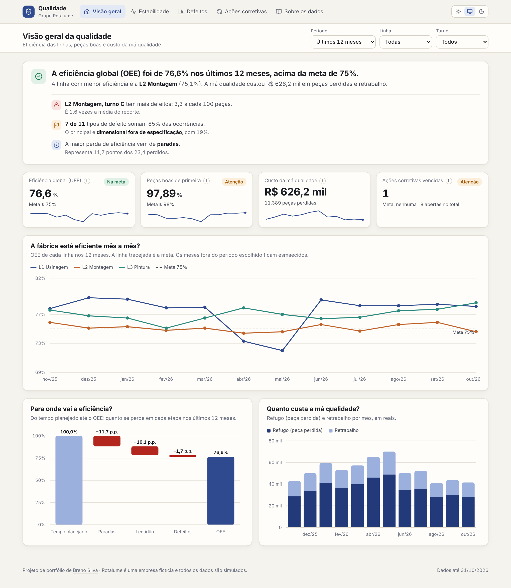
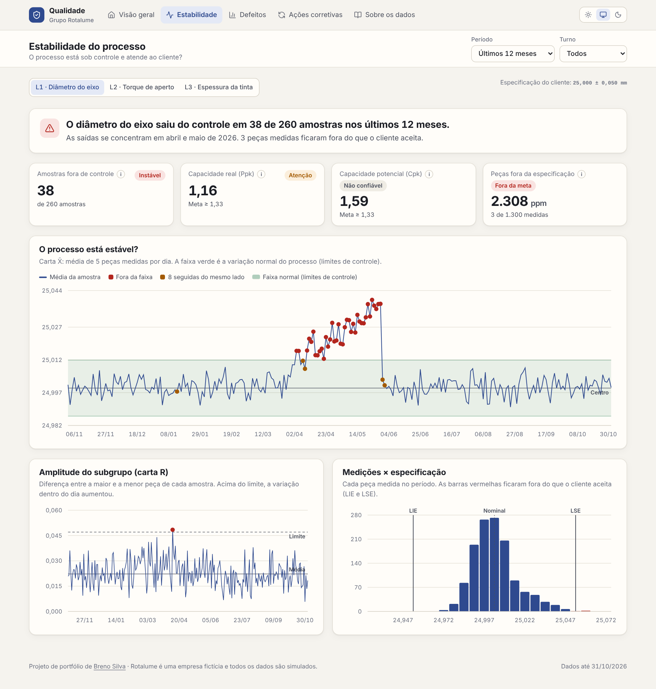
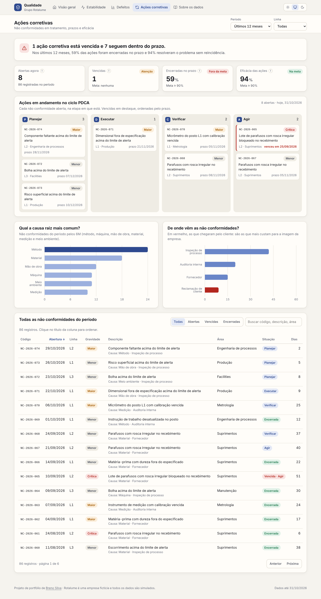

# Painel de Qualidade e Processos — Rotalume Indústria

[](https://github.com/Oberon-23/painel-qualidade-rotalume/actions/workflows/ci.yml)

> Dashboard interativo de qualidade industrial de uma fábrica **fictícia** (Rotalume Indústria), em React + TypeScript, sem backend. Traz OEE, Controle Estatístico de Processo (CEP) e um quadro de ações corretivas no padrão PDCA.



## O que o painel responde

- A fábrica está eficiente mês a mês (OEE)?
- O processo está estatisticamente estável, ou há uma causa especial a investigar?
- Quais defeitos atacar primeiro (Pareto 80/20)?
- Qual é a causa raiz mais comum das não conformidades (Ishikawa 6M)?



## Por que essas escolhas

- **OEE (Disponibilidade × Performance × Qualidade)**: indicador padrão de eficiência industrial (TPM, Nakajima 1988). Junta três perdas diferentes em um único número comparável entre linhas.
- **Cartas de controle X̄-R com regras de Western Electric**: em vez de olhar só a média, o painel aplica controle estatístico de processo de verdade — separa variação normal de causa especial, com os limites calculados a partir dos primeiros 25 dias medidos (Montgomery, *Introduction to Statistical Quality Control*).
- **Cpk tratado como "não confiável" quando o processo está fora de controle**: Cpk só é válido com processo estatisticamente estável; quando não está, o painel mostra esse alerta em vez de um número de capacidade enganoso, e aponta para o Ppk.
- **Pareto + diagrama de Ishikawa (6M)**: metodologia clássica de análise de causa raiz — identifica os poucos defeitos que concentram 80% das ocorrências e depois classifica a causa por Método, Máquina, Mão de obra, Material, Medição e Meio ambiente.
- **Quadro PDCA**: as ações corretivas seguem o ciclo Planejar → Executar → Verificar → Agir, alinhado à ISO 9001:2015, cláusula 10.2.
- **Eventos simulados nos dados** (desgaste de ferramenta, equipe nova sem padronização, umidade afetando pintura): testam se os indicadores conseguem de fato detectar os problemas que foram colocados de propósito.
- **React + TypeScript com dados gerados no navegador**: os dados sintéticos são criados no próprio navegador (semente fixa, reprodutível) e a aplicação é publicada como site estático, sem backend. Cada tela abre com uma manchete que diz o resultado em uma frase, antes dos gráficos.



## Dados

Todos os dados são fictícios, gerados no navegador ao carregar a página. Os eventos simulados e as fórmulas usadas (OEE, Cpk/Ppk, limites de controle) estão detalhados na aba **"Sobre os dados"** do próprio painel.

## Deploy

Aplicação estática feita com Vite. Na Vercel, basta importar o repositório: o framework é detectado sozinho (build `npm run build`, saída `dist/`). O `vercel.json` redireciona as rotas para o `index.html`, então links diretos como `/estabilidade` funcionam.

**Localmente:**
```bash
npm install
npm run dev       # desenvolvimento
npm run build     # gera dist/
npm test          # testes dos cálculos
```

A versão anterior, em HTML puro com Chart.js, está preservada em `legado.html`.

## Stack

React 19 + TypeScript, Vite, React Router e ícones Lucide. Os gráficos são SVG próprio, sem biblioteca (o painel caiu de cerca de 740 KB para 330 KB e passou de 64–73 para 95–98 no Lighthouse do celular); as dicas funcionam com mouse, toque e setas do teclado. O tema claro/escuro usa variáveis CSS e os gráficos leem as mesmas cores, então mudam junto com o tema. Os filtros ficam salvos no navegador. A identidade visual é compartilhada com os outros painéis da Rotalume.

## Testes

- `npm test`: regras de cálculo (OEE, CEP, Pareto) e a ligação com o SGQ.
- `npm run e2e` (depois do build): as cinco telas no computador e no celular, sem erro no console nem rolagem lateral; filtros salvos; dicas dos gráficos com mouse e teclado; clique no Pareto; troca de característica no CEP; busca e links para o SGQ; tema escuro; acessibilidade (WCAG 2.1 AA) no tema claro e no escuro. Roda no CI a cada envio, com os mesmos cabeçalhos de segurança da Vercel.

## Ligação com o SGQ Rotalume

As não conformidades que aparecem com **Ver no SGQ** são as mesmas do [SGQ Rotalume](https://sqgrotalume.vercel.app): mesmo código, assunto, linha e etapa. O painel mostra o quadro geral; o SGQ, o tratamento de cada uma (5 porquês, plano de ação, eficácia). A lista fica em `NO_SGQ`, em `src/dados.ts`, e um teste garante que ela continua valendo.

## Referências

Montgomery, *Introduction to Statistical Quality Control*; Western Electric, *Statistical Quality Control Handbook* (1956); Nakajima, *Introduction to TPM* (1988); ISO 9001:2015.
